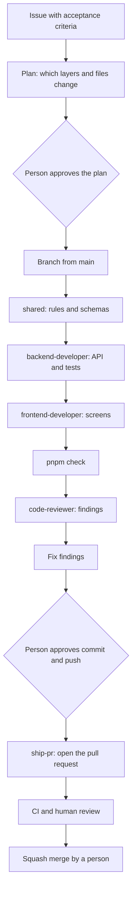

# Working with agents

This project is meant to be changed by people and by AI agents, with the same rules for both. This page explains how the pieces fit together and how a task flows from an issue to a merged pull request.

## One source of rules

| File              | Read by                      | Holds                                                                        |
| ----------------- | ---------------------------- | ---------------------------------------------------------------------------- |
| `AGENTS.md`       | Every agent and every person | All project rules: structure, layers, naming, team rules, definition of done |
| `CLAUDE.md`       | Claude Code                  | Imports `AGENTS.md` and lists the Claude Code agents and skills              |
| `CONTRIBUTING.md` | Everyone                     | Branches, commits, PRs and reviews                                           |
| `docs/`           | Everyone, on demand          | The detail behind each rule                                                  |

Rules are never duplicated between these files. `AGENTS.md` states a rule in one line and links to the document that explains it. Tools that do not read `CLAUDE.md` (Codex, Cursor, Copilot) still get every rule from `AGENTS.md`.

## Claude Code setup

```
.claude/
├── agents/
│   ├── backend-developer.md    API and shared package work
│   ├── frontend-developer.md   panel work
│   └── code-reviewer.md        read-only review of a diff
├── skills/
│   ├── ship-pr/SKILL.md        from a finished change to an open pull request
│   ├── add-bmi-band/SKILL.md   add, split, change, rename or remove a BMI band
│   └── new-backend-module/SKILL.md   a new API resource with every layer and its tests
└── settings.json               what runs without asking, what asks first, what is denied
```

- **Agents** are specialists with their own instructions, tools and model (Opus). The main session delegates a focused task to one of them and gets back a report. Each agent file states:
  - **Ownership:** the folders it may change. Anything else becomes a finding for its owner, so two agents never edit the same files.
  - **Expected inputs:** what the session must pass (issue, acceptance criteria, branch and, for the frontend, the API contract). Missing input means `status: blocked` with a question, never a guess.
  - **Workflow:** triage, implementation order and validation, stopping after two failed attempts at the same check.
  - **Report:** a fixed structure with the status, each acceptance criterion as changed or explained, files, check results, the API contract, findings for other owners, decisions for the PR description and what was not verified.
  - **Anti-patterns:** concrete mistakes to avoid in this code base.
- **Skills** are step by step guides for tasks that repeat. New skills are added together with the code they teach how to change, so a skill never describes code that does not exist yet.
- **Settings** turn the rules into guardrails: the checks run without a prompt, commits, pushes and dependency changes always ask, and force pushes, merges and `.env` reads are denied. The list is in `CLAUDE.md`.
- **CI** runs the same `pnpm check` on GitHub for every pull request, plus a check of the PR title, so an agent's work is verified the same way as a person's.

## How a task flows



Not every task touches every layer: a screen tweak skips the shared and backend steps. The order matters when it does: contracts first, then the API, then the panel.

## Where people stay in control

- Approving the plan before code is written.
- Every commit, every push and opening each pull request.
- The final review and the merge.
- Any change to GitHub settings, CI secrets or branch protection.
- Adding a dependency or approving its install scripts or agent skills.

Agents never merge, never force push and never turn off a check to make it pass.

## Asking an agent for a task

A good request names the outcome, the place in the system and how to know it is done. For example:

> Add a "last assessment" column to the users list, visible to administrators and teachers. It shows the date of the latest assessment of each student, or a dash when there is none. Done when the column shows up, sorting is unchanged, and the users e2e test covers a student with and without assessments.

The agent should answer with a plan listing the files per layer before changing anything.

## Adding a new agent or skill

- Create an agent when a kind of task needs different instructions or tools (for example, read-only review). Create a skill when a sequence of steps repeats.
- Keep the instructions short and point to `AGENTS.md` and `docs/` instead of copying rules.
- List it in `CLAUDE.md` and in this page in the same PR.
