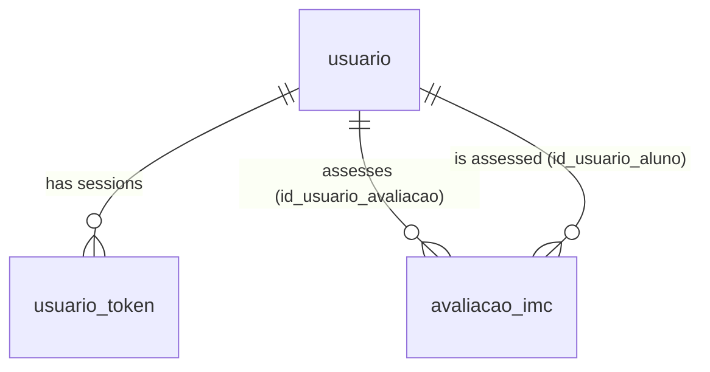

# Database

SQLite through the `better-sqlite3` driver, accessed with TypeORM 1. The schema is versioned by migrations, and `synchronize` is always off.

## Tables

Table, column and stored values follow the data model defined in Portuguese. The code works with English names, and the translation happens in one place (see [below](#portuguese-values-english-code)).

### `usuario`

| Column        | Type         | Notes                                              |
| ------------- | ------------ | -------------------------------------------------- |
| `id`          | varchar(36)  | UUID, primary key                                  |
| `nome`        | varchar(60)  | Full name                                          |
| `usuario`     | varchar(60)  | Username, unique, stored in lowercase              |
| `senha`       | varchar(255) | bcrypt hash                                        |
| `perfil`      | varchar(20)  | `admin`, `professor` or `aluno` (check constraint) |
| `situacao`    | varchar(10)  | `ativo` or `inativo` (check constraint)            |
| `dt_inclusao` | datetime     | Creation date                                      |

### `usuario_token`

| Column            | Type         | Notes                                     |
| ----------------- | ------------ | ----------------------------------------- |
| `id`              | varchar(36)  | UUID, primary key                         |
| `refresh_token`   | varchar(255) | SHA-256 hash of the refresh token, unique |
| `id_usuario`      | varchar(36)  | Foreign key to `usuario.id`               |
| `expiracao_token` | datetime     | Expiration                                |
| `dt_inclusao`     | datetime     | Creation date                             |

### `avaliacao_imc`

| Column                 | Type         | Notes                                         |
| ---------------------- | ------------ | --------------------------------------------- |
| `id`                   | varchar(36)  | UUID, primary key                             |
| `altura`               | decimal(5,2) | Height in meters                              |
| `peso`                 | decimal(5,2) | Weight in kilograms                           |
| `imc`                  | decimal(5,2) | BMI calculated by the API                     |
| `classificacao`        | varchar(30)  | Band name, for example `Sobrepeso`            |
| `id_usuario_avaliacao` | varchar(36)  | Foreign key to `usuario.id`: who assessed     |
| `id_usuario_aluno`     | varchar(36)  | Foreign key to `usuario.id`: who was assessed |
| `dt_inclusao`          | datetime     | Assessment date                               |

### Relationships and indexes

- Every foreign key is `ON UPDATE CASCADE` and `ON DELETE NO ACTION`. A user with assessments cannot be deleted, which is also a business rule.
- Indexes: `usuario_token(id_usuario)`, `avaliacao_imc(id_usuario_aluno, dt_inclusao)` for a student's history, `avaliacao_imc(id_usuario_avaliacao)` for the teacher filter and `avaliacao_imc(dt_inclusao)` for the monthly counter.
- The migrations only use types that SQL Server also accepts, so switching databases later does not mean rewriting them.

## Portuguese values, English code

| In the code                  | Stored                                |
| ---------------------------- | ------------------------------------- |
| role `admin`                 | `admin`                               |
| role `teacher`               | `professor`                           |
| role `student`               | `aluno`                               |
| status `active` / `inactive` | `ativo` / `inativo`                   |
| classification `overweight`  | `Sobrepeso` (and so on, one per band) |

- Column names are mapped with `name:` in the TypeORM `EntitySchema` files.
- Values are translated by the transformers in `infra/database/column-values.ts`, used by the schemas.
- In `andWhere` of a query builder and in `getRaw*` results the transformer does not run. Use `roleColumnValues.toColumnValue(...)` and `bmiClassificationColumnValues.fromColumnValue(...)` there.
- The stored classification is the official band name. Renaming a band later needs a migration that updates the old rows.

Reasoning in [decision 0004](../decisions/0004-database-in-portuguese-code-in-english.md).

## Migrations

- Live in `apps/backend/src/infra/database/migrations` and are registered in `data-source.ts`.
- One migration per change, named `<timestamp>-<what-it-does>.ts`, with `up` and `down`.
- A migration that was already applied anywhere is never edited. To fix it, write a new one.
- `pnpm db:migrate` applies the pending migrations and `pnpm db:revert` reverts the last one. Both read `DB_DATABASE` from `apps/backend/.env`. In production, after the build, `node dist/migrate.mjs` applies them without TypeScript tooling.
- The end-to-end tests run every migration on an in-memory database before each test, and `test/database.test.ts` checks the tables, the stored Portuguese values and the revert.
- The API logs a warning on startup if there are pending migrations.

## Demo data

`pnpm db:seed` applies the migrations and recreates the database with a demo gym: an administrator, teachers, students with assessment history, an inactive teacher, an inactive student and a student with no assessments. It deletes existing data and refuses to run with `NODE_ENV=production`.
