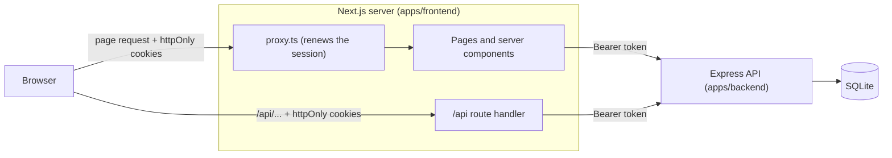

# Architecture overview

## Repository layout

```
imc-calculator/
├── apps/
│   ├── backend/     REST API: Express, TypeORM, SQLite, Zod, JWT
│   └── frontend/    Panel: Next.js (App Router), Chakra UI, TanStack Query, React Hook Form
├── packages/
│   └── shared/      BMI rules, roles, Zod schemas and API types used by both apps
├── docs/            This documentation
├── .claude/         Claude Code agents, skills and settings
└── .github/         Issue and PR templates, CI workflows
```

## How a request travels

The browser only talks to the Next.js server. The Next.js server is the only one that knows the API address and the session tokens.



Two common paths:

1. **Opening a page.** `proxy.ts` checks the session cookies and renews the access token if it expired. The page checks the role, renders the header right away, and a server component fetches the data from the API with the token and hands it to TanStack Query already filled in. The screen opens complete, with no loading flash.
2. **Saving a form.** The hook calls a service, the service calls `/api/...` on the Next.js server, the route handler adds the token from the cookie and forwards the request to the API. On success, the hook refreshes the lists that changed.

## Where each kind of rule lives

| Rule                                              | Place                                                         |
| ------------------------------------------------- | ------------------------------------------------------------- |
| BMI calculation and band table                    | `packages/shared/src/bmi.ts`                                  |
| Input validation (body, query, forms)             | Zod schemas in `packages/shared`                              |
| Who can do what                                   | Services in `apps/backend/src/modules/*`                      |
| Which screens and buttons each role sees          | `apps/frontend/src/lib/permissions.ts`                        |
| Translation between code values and stored values | `apps/backend/src/infra/database/column-values.ts`            |
| Configuration                                     | `apps/backend/src/config/env.ts` and the `.env.example` files |

## Main decisions

- [0001: pnpm monorepo](../decisions/0001-pnpm-monorepo.md)
- [0002: shared rules package](../decisions/0002-shared-rules-package.md)
- [0003: backend layers and dependency injection](../decisions/0003-backend-layers-and-dependency-injection.md)
- [0004: database in Portuguese, code in English](../decisions/0004-database-in-portuguese-code-in-english.md)
- [0005: session in httpOnly cookies through Next.js](../decisions/0005-session-in-httponly-cookies.md)
- [0006: who the teacher's students are](../decisions/0006-teacher-students.md)
- [0007: pinned versions](../decisions/0007-pinned-versions.md)
- [0008: dependency supply chain guards](../decisions/0008-dependency-supply-chain-guards.md)

Details of each side: [backend.md](backend.md), [frontend.md](frontend.md), [database.md](database.md).
